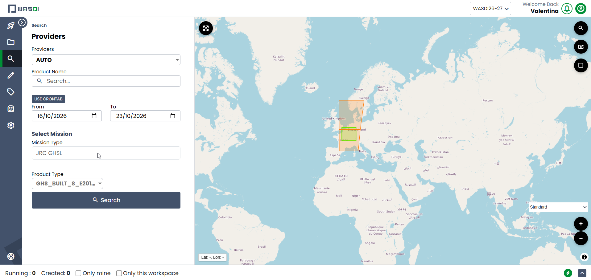
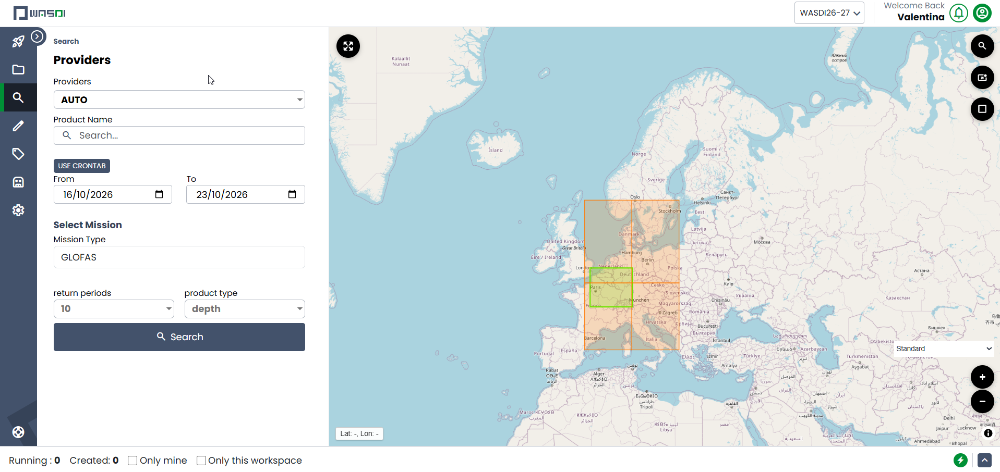

Joint Research Centre (JRC)
=========================================

From the Join Reseach Centre, WASDI fetches two products from the **Global Human Settlement Layer (GHSL)** and the **Global Flood Awareness System (GloFAS)**.

Global Human Settlement Layer (GHSL)
------------------------------------------

* Reference page: `GHSL - direct download for advanced users <https://human-settlement.emergency.copernicus.eu/download.php>`_
* Product: GHS-BUILT-S

  * Epoch: 2018
  * Resolution 10m
  * Coordinate system: Mollweide

* Download page: `GHS_BUILT_S_E2018_GLOBE_R2023A_54009_10/V1-0/tiles <https://jeodpp.jrc.ec.europa.eu/ftp/jrc-opendata/GHSL/GHS_BUILT_S_GLOBE_R2023A/GHS_BUILT_S_E2018_GLOBE_R2023A_54009_10/V1-0/tiles/>`_

Global Flood Awareness System (GloFAS)
------------------------------------------

* Reference page: `Copernicus Emergency Management Service - Floods <https://global-flood.emergency.copernicus.eu/>`_
* Product: GloFAS flood hazard
* Download page: `CEMS-GLOFAS/flood_hazard <https://jeodpp.jrc.ec.europa.eu/ftp/jrc-opendata/CEMS-GLOFAS/flood_hazard/>`_

